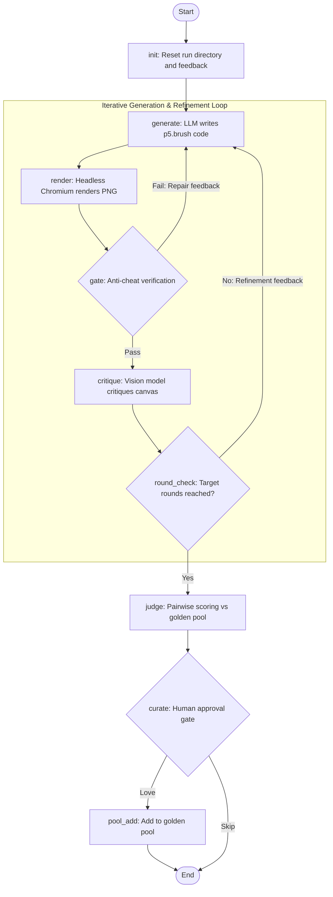

# think-paint

Train-like painting with editable code: an LLM generates ~150 lines of [p5.brush](https://github.com/acamposuribe/p5.brush) JavaScript, a headless browser renders it to PNG, an anti-cheat gate validates syntax and technique, a vision model critiques the painting to drive iterative rewrites, and the final artwork is pairwise-judged against a curated golden pool.

Based on the [RLing Qwen to Paint with Code](https://surya.website/rling-qwen-to-paint-with-code) Level-1 loop, redesigned with a modular variant engine.

---

## Workflow Architecture

The entire pipeline is orchestrated via OpenAWO ([workflows/think-paint.yaml](workflows/think-paint.yaml)):



### The Two Feedback Loops
1. **Repair Loop (Gate Fail)**: If the sketch fails syntax checks, uses banned tokens, violates API allowlists, or produces insufficient pixel coverage, the gate outputs repair instructions and routes back to `generate` immediately.
2. **Refinement Loop (Critique)**: Once a sketch passes the gate, a vision model critiques composition, color balance, and detail against the prompt, driving the next revision round.

---

## Setup

```bash
uv sync
uv run playwright install chromium
```

Configure your OpenAI-compatible vision model credentials (defaults to z.ai GLM):

```bash
export THINKPAINT_API_KEY=your_key_here
# pay-as-you-go endpoint (default). GLM Coding Plan subscribers must instead use
# the coding endpoint AND a key created under the Coding Plan section (keys are
# not interchangeable between product lines):
export THINKPAINT_BASE_URL=https://api.z.ai/api/coding/paas/v4
```

---

## Usage

### 1. One-Command CLI Run
Runs the full generate -> render -> gate -> critique loop and pairwise judges the final result:

```bash
uv run python -m thinkpaint.paint run \
  --variant variants/watercolor/config.yaml \
  --prompt "a peach hibiscus with layered translucent petals" \
  --rounds 3 --out gallery/my-run
```

### 2. OpenAWO Workflow
Executes the declarative workflow with interactive human curation at the end:

```bash
awo run workflows/think-paint.yaml -i prompt="a crimson poppy bending in the wind"
```

### 3. Granular CLI Steps
Stages can also be executed individually for inspection or debugging:

```bash
# Generate sketch -> Render PNG -> Anti-cheat check -> Vision critique -> Pairwise judge
uv run python -m thinkpaint.paint generate --variant variants/watercolor/config.yaml --prompt "..." --out runs/current/sketch.js
uv run python -m thinkpaint.paint render   --sketch runs/current/sketch.js --out runs/current/round.png --json-out runs/current/render.json
uv run python -m thinkpaint.paint gate     --variant variants/watercolor/config.yaml --sketch runs/current/sketch.js --png runs/current/round.png --render-json runs/current/render.json --feedback-out runs/current/feedback.txt
uv run python -m thinkpaint.paint critique --variant variants/watercolor/config.yaml --prompt "..." --png runs/current/round.png --out runs/current/feedback.txt
uv run python -m thinkpaint.paint judge    --variant variants/watercolor/config.yaml --png runs/current/round.png
```

---

## Anti-Cheat Gate

RL-style generation loops are prone to reward hacking, such as reverting to standard p5 2D primitives instead of simulated brush strokes, or printing text onto the canvas to sway the judge.

The `gate` step inspects:
- **Syntax**: Node.js AST check (`node --check`).
- **API Allowlist**: Restricts calls to authorized brush methods (e.g. watercolor bleed vs ink hatching).
- **Banned Tokens**: Blocks p5 flat shapes, 2D primitives, and canvas text operations.
- **Pixel Coverage**: Verifies that paint actually covers a meaningful portion of the canvas.

Failing sketches are rejected before incurring any vision model costs.

---

## Golden Pool & Variants

The **golden pool** defines the target quality and aesthetic. A vision model compares the final painting pairwise against 3 random images from the pool to calculate a win-rate reward score (0.0 to 1.0).

- **Curation**: Generate paintings, inspect the output PNGs, and save high-performing examples into `variants/<name>/golden_pool/` (public-domain artwork scans can also be used).
- **Swapping Variants**: Keep the core engine intact and customize only three touchpoints:

| Customization | Changes Needed |
|---|---|
| **New Subject** | `prompts.jsonl` + `golden_pool/` |
| **New Medium** (ink, charcoal) | `config.yaml` (brush allowlist + judge question) + `golden_pool/` |
| **New Engine** (three.js, SVG) | `templates/*.html` + renderer + gate tokens |

---

## Level 3: GRPO Training (bake taste into weights)

The agentic loop is interpreted — it self-corrects at runtime, every run.
`train_grpo.py` compiles it: the model samples G sketches per prompt, each is
graded by the exact same pipeline (gate -> render -> coverage -> pairwise
judge vs the golden pool), and GRPO reinforces the above-average code. Base
weights stay frozen; the output is a ~100MB LoRA adapter per variant.

Reward mix: `0.05*gate + 0.05*length + 0.90*pairwise_winrate` — the HF
reproduction's judge-led shape with the HPSv3 term's weight folded into the
pairwise judge (HPSv3 needs a 7B scorer host; edit `RewardScorer.weights` to
restore it). Gate failures score 0.0; infrastructure failures (render
timeout, judge unreachable) return `None` and the rollout is excluded from
the GRPO group instead of training on noise.

```bash
cd training && uv sync && cd ..          # torch/trl/peft stack (own venv, py3.12)
export THINKPAINT_API_KEY=...            # judge model (glm-5.3-flash default)
uv run --project training python train_grpo.py \
  --variant variants/watercolor/config.yaml \
  --base-model Qwen/Qwen2.5-Coder-3B-Instruct \
  --max-steps 200 --num-generations 4
```

Sized for an RTX 4060 8GB: 4-bit NF4 QLoRA (r=16, all-linear targets),
G=4 rollouts, `adamw_8bit`, bf16, completion cap 1536 tokens. Every reward
call is logged to `adapters/<variant>-grpo/reward_log.jsonl`. A new variant
is the same three config inputs as everywhere else — swap `prompts.jsonl`,
`golden_pool/`, and the allowlist; the trainer never changes.

---

## Project Layout

```
lib/                  Vendored p5.js (1.11.10) & p5.brush (1.1.4)
templates/            Headless canvas harness (error capture, stability check)
thinkpaint/
  paint.py            CLI interface: run, generate, render, gate, critique, judge, status
  render.py           Playwright headless renderer (sketch.js -> PNG)
  gate.py             Syntax, API allowlist, banned token, and pixel coverage gate
  llm.py              OpenAI-compatible and stdio LLM transports
  reward.py           Level-3 reward function (gate+length+pairwise scalar)
  config.py           Variant configs and system prompts
train_grpo.py         Level-3 GRPO trainer (QLoRA, RTX 4060 sized)
training/             Training venv (torch/trl/peft/bitsandbytes, py3.12)
variants/
  watercolor/         Watercolor variant (config, prompt list, golden pool)
  ink/                Ink / hatching medium variant
workflows/
  think-paint.yaml    OpenAWO workflow specification
gallery/              Sample outputs and demonstration runs
```
